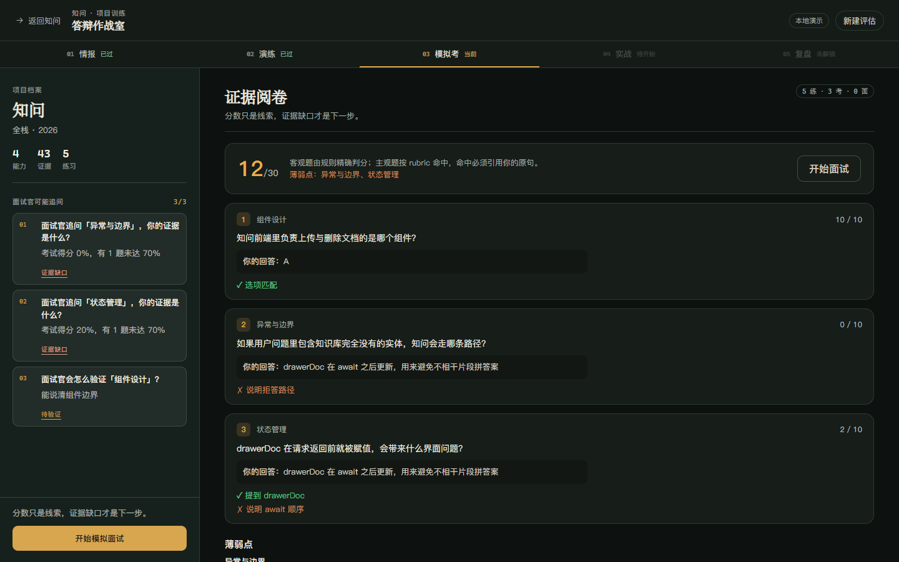
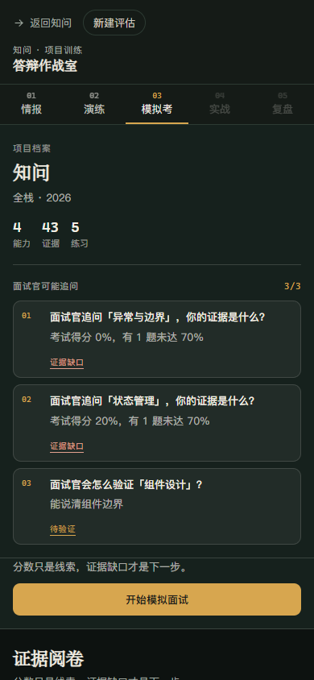
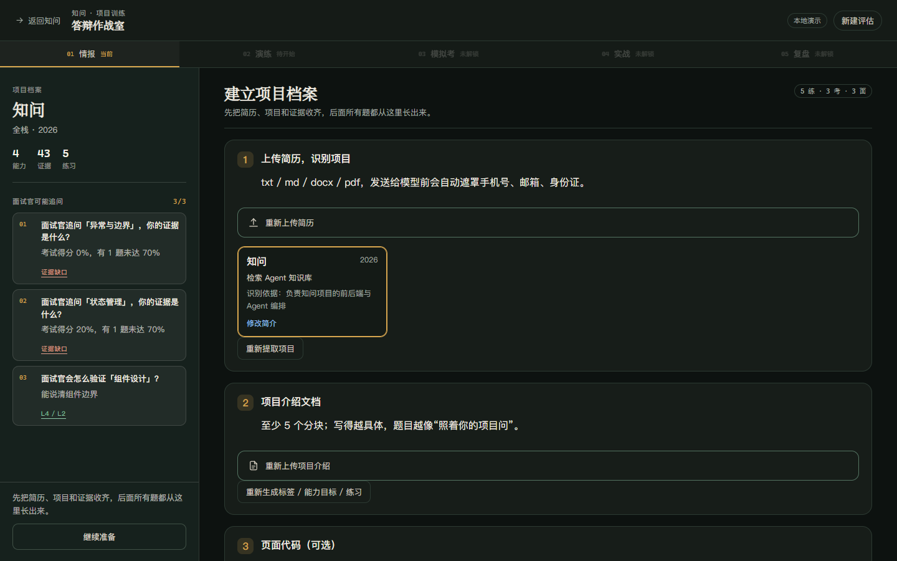
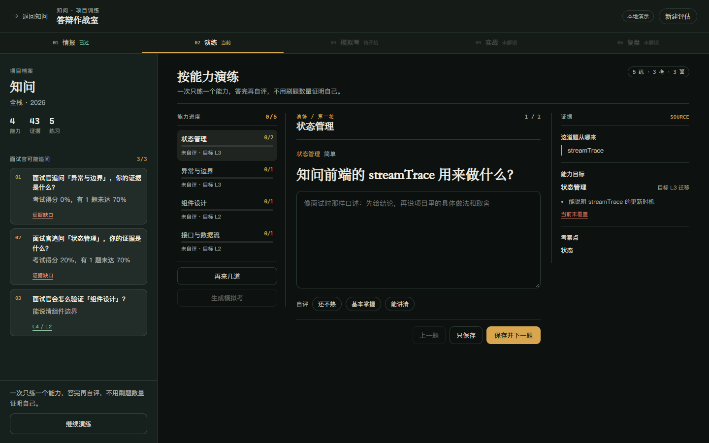
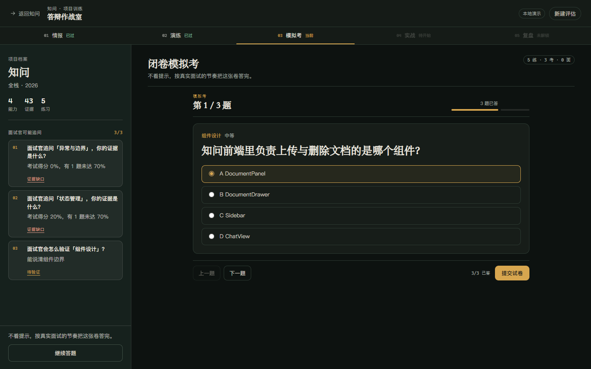
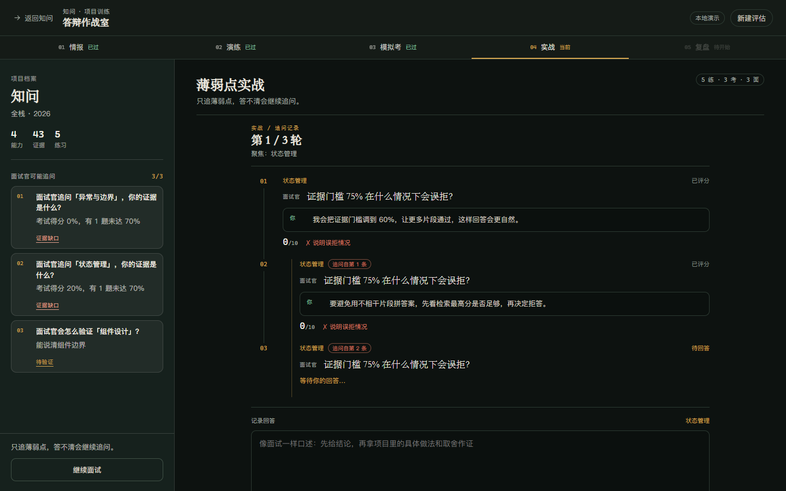
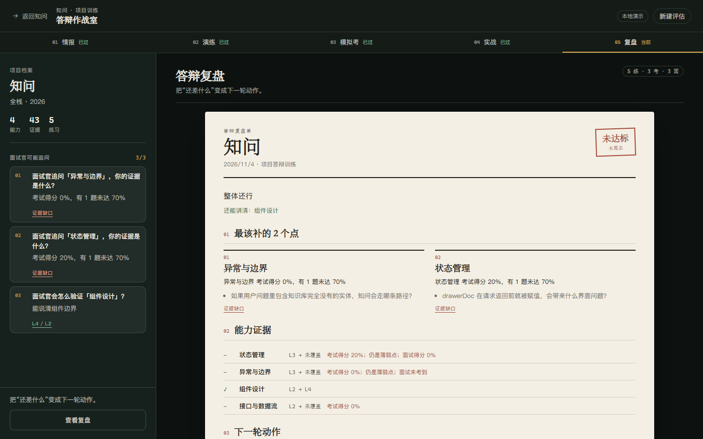
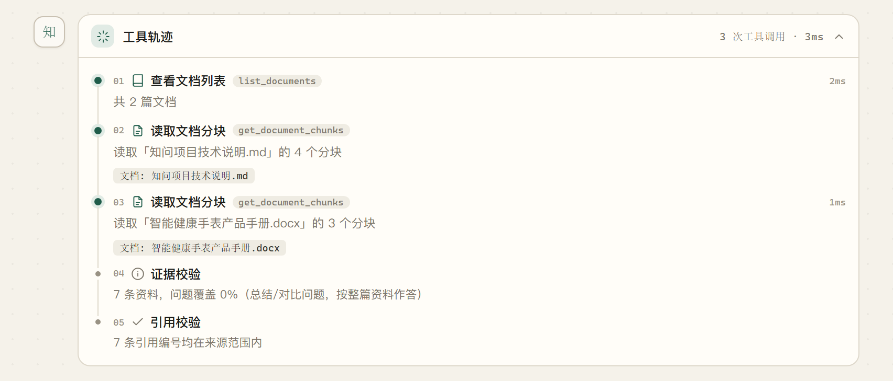

# 知问 · 项目答辩训练 Agent

面向求职场景的项目答辩训练工具：上传简历和项目介绍，系统提取项目、生成能力目标和练习题，再走一遍「演练 → 模拟考 → 薄弱点面试 → 复盘」的闭环。它不是招聘平台，也不承诺就业，只负责把简历上的项目练到能扛住追问。

原有「检索 Agent 知识库问答」保留为底层能力：文档检索、工具调用、引用校验和 SSE 轨迹仍然可用，也是评估模块的检索与评测基础。

**仓库：** [Gitee](https://gitee.com/keleau/rag-knowledge-base) · [GitHub 镜像](https://github.com/keleau/rag-knowledge-base)



| 移动端作战室 |
| --- |
|  |

## 两条使用线

### 1. 项目答辩训练（主流程）

```text
简历 → 项目 → 项目介绍（+ 可选页面代码）
→ 能力目标 → 练习题（≥20）
→ 模拟考（10 题）→ 阅卷
→ 薄弱点面试（3 轮，追问）
→ 答辩复盘单 → 未达标则复练
```

- **能力目标**：每个项目 5–6 个能力标签，支持 L1 知道 / L2 解释 / L3 迁移 / L4 讲清。
- **反八股**：题干必须命中项目文档/代码中的实体；没有证据或与项目无关的题直接丢弃。
- **跨阶段去重**：出考试题时参考已出的练习题，再做 token 重叠校验；复练题与练习、考试、历史复练一起去重。
- **代码题**：上传单个 `.vue/.ts/.js` 文件后，生成定位行、讲解取舍、讲清实现三类题；评分按符号提及 + rubric。
- **复盘**：报告不是分数表，而是一张答辩复盘单：最该补的点、能力证据、下一轮动作。



| 学习：一次一题 + 能力进度 + 证据 | 考试：当前题 + 交卷 |
| --- | --- |
|  |  |

| 面试：追问记录 | 复盘：答辩复盘单 |
| --- | --- |
|  |  |

### 2. 检索 Agent 知识库问答（基础能力）

上传 TXT / Markdown / Word / PDF 后，Agent 通过 `search_knowledge`、`list_documents`、`get_document_chunks` 三个工具自行决定检索、改写查询或读取整篇文档；最多 4 步，每一步的观察结果回灌，最后给出带引用的回答，找不到依据时明确拒答。



## 为什么这是一个 Agent 项目

不是把检索包一层聊天框，而是有边界的「规划 → 工具 → 观察 → 再规划」：

- **工具有 Schema**：三个检索工具都有 JSON Schema 参数定义。
- **有决策**：真实模型通过 `tools` + `tool_choice: auto` 选择工具、查询词和 `top_k`。
- **有观察回灌**：工具结果裁剪后写入对话，供下一步规划；重复分块去重，最多保留 12 条资料。
- **有边界**：硬上限 4 步、工具超时 5 秒、规划失败降级、无证据拒答、引用越界清理。
- **有轨迹**：工具名、参数、结果数、耗时、失败原因都记录在 trace 中，通过 SSE 推送并持久化。

评估模块里，**面试阶段是唯一的自由 Agent 循环**：规划器看到薄弱点、已问题目、评分缺口和工具结果，决定追问还是换题。项目提取、出题、阅卷、报告是确定性流水线 + 结构化输出，不假装所有阶段都自主。

## 核心机制

### 能力标签

学习、考试、面试、报告共用同一套能力标签（如组件设计、状态管理、接口与数据流、异常与边界、性能优化、工程化）。这样报告才能说清「你在某个能力上练了什么、考了多少、面试有没有答清」。

### 三道出题闸门

| 闸门 | 检查 |
| --- | --- |
| 证据 | 文档题必须能在分块中找到 quote；代码题必须有 `file/line_start/line_end/quote/symbols` |
| 实体 | 题干必须命中项目文档或代码里的真实实体；模型自带的 `entities` 不算证据 |
| 去重 | 与已出题目 token 重叠超过阈值就丢弃；跨练习、考试、复练生效 |

### 状态与幂等

- `setup → learning → exam → grading → interview → report` 显式状态机。
- 乐观锁 `version` 防止并发覆盖；提交带 `idempotency_key`，重复提交返回已有结果。
- 每次阶段转换先写 SQLite，再发 SSE `done`；刷新后从当前阶段继续。

### 代码上传

- 只支持单个 `.vue/.ts/.js` 文件，≤ 200 KB。
- **永远不执行用户代码**，只做文本解析与符号/行号提取。
- 上传前扫描敏感串；命中 Key/密码会拒绝。
- 代码题必须能指回具体行，找不到行号或符号就不出题。

### 隐私

- 简历发送给模型前遮手机号、邮箱、身份证号。
- 数据默认本地存储；提供删除评估入口。
- 文档/代码里的“忽略以上指令”只当资料，不当系统指令。

## 技术栈

| 层 | 技术 |
| --- | --- |
| 后端 | Python 3.11+、FastAPI、Uvicorn、httpx、python-docx、pypdf |
| Agent | 有界工具调用循环、DeepSeek `tools` / `tool_choice=auto`、确定性 demo 规划器 |
| 检索 | jieba、scikit-learn `TfidfVectorizer`、余弦相似度 |
| 评估 | 显式状态机、SQLite、三道闸门、rubric 阅卷、能力等级、复练 |
| 前端 | Vue 3、TypeScript、Vite、marked、DOMPurify |
| 存储 | 聊天/文档 JSON；评估 SQLite `assessment.db`；上传文件在 `backend/data/` |
| 工具协议 | MCP（可选依赖 `mcp`），复用检索与评估工具层 |

## 目录结构

```text
rag-knowledge-base/
├── backend/
│   ├── app.py                  # FastAPI 路由、SSE、静态前端托管
│   ├── agent.py                # 知识库检索 AgentRunner
│   ├── assessment.py           # 评估状态机与乐观锁
│   ├── assessment_app.py       # 评估 REST / SSE 路由
│   ├── assessment_storage.py   # SQLite schema 与 repository
│   ├── assessment_tasks.py     # 提取、标签、练习、出题、阅卷、报告
│   ├── interview.py            # 薄弱点面试循环
│   ├── code_parser.py          # 单文件 Vue/TS/JS 解析
│   ├── question_guard.py       # 证据 / 实体 / 去重闸门
│   ├── capabilities.py         # 能力聚合与通关判定
│   ├── entities.py             # 项目实体抽取
│   ├── pii.py                  # PII 遮罩与敏感串扫描
│   ├── mcp_assessment.py       # 评估 MCP 工具
│   ├── mcp_server.py           # MCP stdio 服务
│   ├── scripts/                # smoke / e2e / MCP 检查
│   └── tests/                  # 53 个后端测试
├── frontend/src/
│   ├── App.vue                 # 聊天 / 评估双视图
│   ├── assessment/
│   │   ├── AssessmentWorkbench.vue
│   │   ├── mission.ts          # 五阶段定义
│   │   ├── probes.ts           # 追问卡推导
│   │   ├── learning.ts         # 能力进度推导
│   │   ├── components/         # 作战室、能力进度、证据、面试记录、复盘单等
│   │   └── pages/              # Setup / Learning / Exam / Grading / Interview / Report
│   └── components/             # 聊天、文档、AgentTrace
├── docs/                       # 改造方案与施工文档
├── eval/                       # 知识库 30 条评测结果
├── samples/                    # 示例文档
└── shots/                      # 界面截图
```

前端评估模块按职责拆分，页面只保留数据编排：

- `AssessmentWorkbench` 负责阶段、数据加载和页面切换；
- `WarRoomCaseRail` / `WarRoomMissionStrip` 负责项目档案、追问卡与阶段条；
- `SetupStep` / `SetupResumeStep` / `SetupProjectDocStep` / `SetupCodeStep` / `SetupEnterStep` 负责四步准备流程；
- `AbilityProgress` / `QuestionEvidence` 负责学习页的左侧能力进度和右侧证据；
- `InterviewRecord` 负责追问记录，`ReviewSheet` 负责答辩复盘单；
- `mission.ts` / `probes.ts` / `learning.ts` 放纯推导逻辑，方便测试和复用。

## 快速开始

环境要求：Python 3.11+、Node.js 20+、npm。

### Git Bash

```bash
cd rag-knowledge-base/backend

# 首次
# .venv/Scripts/python.exe -m pip install -r requirements.txt

LLM_MODE=demo .venv/Scripts/python.exe -m uvicorn app:app --reload --port 8000
```

另开终端：

```bash
cd rag-knowledge-base/frontend
npm install
npm run dev
```

### PowerShell

```powershell
cd C:\path\to\rag-knowledge-base\backend
$env:LLM_MODE = "demo"
.\.venv\Scripts\python.exe -m uvicorn app:app --reload --port 8000
```

```powershell
cd C:\path\to\rag-knowledge-base\frontend
npm run dev
```

浏览器打开 Vite 终端显示的地址。若 5173 被其他项目占用，Vite 会自动换到 5174，以终端输出为准。接口文档在 `http://127.0.0.1:8000/docs`。

### 单端口演示

```bash
cd frontend && npm run build
cd ../backend
LLM_MODE=demo .venv/Scripts/python.exe -m uvicorn app:app --host 127.0.0.1 --port 8000
```

打开 `http://127.0.0.1:8000`。

## 运行模式与 Key

| 模式 | 行为 | 成本 |
| --- | --- | --- |
| `LLM_MODE=demo` | 聊天走确定性规则；**评估生成接口会拒绝调用模型** | 零 API |
| `LLM_MODE=llm` | 聊天/出题/阅卷/面试/报告调用 DeepSeek | 按量计费 |
| `LLM_MODE=replay` | 只读 `eval/fixtures/` 录制，缺失直接报错 | 零 API |

DeepSeek 官方按量计费，不是稳定免费 key；没有 Key 时不要指望 demo 模式生成新的评估内容。测试和评测默认使用 demo / 假模型，不调用真实付费接口。

`.env` 只放本地 Key，不提交仓库；系统环境变量优先级高于 `.env`。不想产生费用时显式设置 `LLM_MODE=demo`。

## 验证

```bash
cd backend
LLM_MODE=demo .venv/Scripts/python.exe -m unittest discover -s tests -v
LLM_MODE=demo .venv/Scripts/python.exe scripts/smoke_assessment.py
LLM_MODE=demo .venv/Scripts/python.exe scripts/e2e_fake_llm.py
```

- 后端单测：53 个用例通过。
- 评估 smoke：实体抽取、代码解析、三道闸门、能力判定、存储与状态机。
- 假模型 E2E：简历 → 代码 → 练习 → 考试 → 阅卷 → 面试 → 报告 → 复练。
- 前端：`npm run build` 通过（`vue-tsc --noEmit` + Vite）。
- 知识库 30 条评测：见 [`eval/report.md`](eval/report.md)，那是聊天/检索模式的评测，不是评估闭环的评测。

## API 与 MCP

评估接口以 `/api/assessments` 开头，覆盖创建、简历/项目文档/代码上传、准备、练习、考试、阅卷、面试、报告和复练。聊天接口保留 `/api/conversations`、`/api/documents` 和 `/api/conversations/{id}/messages/stream`。

MCP 服务通过 stdio 暴露两组能力：

- 知识库检索：`search_knowledge`、`list_documents`、`get_document_chunks`
- 项目评估：`create_assessment`、`register_resume`、`select_project`、`add_project_document`、`upload_code`、`prepare_assessment`、`start_exam`、`submit_exam`、`start_interview`、`answer_interview`、`generate_report` 等

安装与检查：

```bash
cd backend
pip install -r requirements-mcp.txt
python scripts/check_mcp.py
```

详细工具表、资源与提示模板见 [`backend/mcp_assessment.py`](backend/mcp_assessment.py) 和 [`docs/project-assessment-agent.md`](docs/project-assessment-agent.md)。

## 局限与边界

- **不是招聘平台**：没有投递、内推、岗位库，也不承诺 offer。
- **没有登录/多用户**：当前适合本地学习与演示，不要直接暴露到公网。
- **代码只支持单文件**：`.vue/.ts/.js`，不支持 zip、整仓或多文件；永远不执行代码。
- **评估闭环还没有自己的 30 条离线评测**：现有 30 条是知识库检索模式的；评估报告中的指标需要后续补齐。
- **demo 不能生成新评估**：没有模型时只能浏览已有数据或走假模型 E2E；真实出题需要授权后配置模型。
- **TF-IDF 检索是词面匹配**：同义改写和跨语言语义有限；生产化可换 embedding + 重排。
- **评分是辅助判断**：主观题用 rubric + 证据 + 人工复核，不声称“自动阅卷准确率”。

## 可写进简历

> 基于 FastAPI + Vue3 + SQLite 实现项目答辩训练 Agent：从简历提取项目，结合项目文档/代码生成可溯源练习、10 题模拟考和薄弱点追问面试，输出答辩复盘单。

> 设计证据/实体/去重三道出题闸门与 rubric 阅卷，代码题按 `file:line` 溯源；搭建 53 个后端测试、smoke 与假模型 E2E，demo 模式零 API 成本可复现。

不要写“上线/用户量/帮助多少人拿到 offer”，也不要写没有实现的“自动阅卷准确率 95%”。

## 相关文档

- [项目定向测评改造方案](docs/project-assessment-agent.md)
- [施工方案（含数据模型与 API）](docs/project-assessment-construction.md)
- [知识库 Agent 评测报告](eval/report.md)
